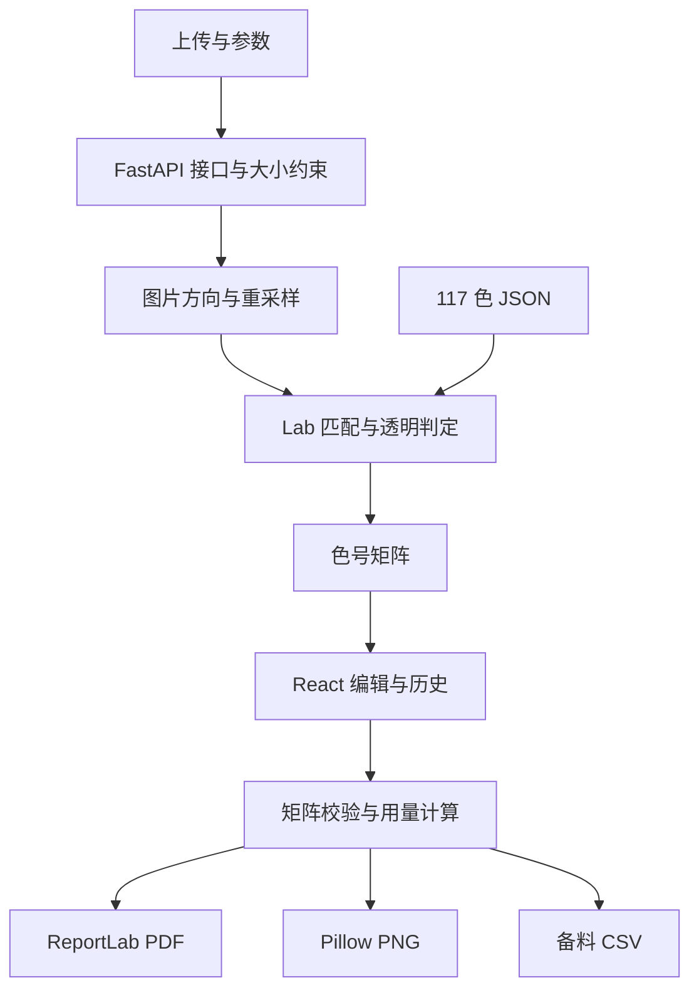

# 豆格：拼豆图纸工具设计方案

## 1. 产品目标与使用对象

用户已经拥有像素图片或其他静态图片，希望得到**可以实际照着摆豆**的图纸。完整流程必须连接“图片颜色”“可购买的实体色号”“底板格子”“备料数量”和“可打印文件”。

典型用户包括首次拼豆的新手、已有有限豆色的爱好者、需要多人分块制作大图的玩家。主要任务是上传图片、确定颗粒度、映射实体色号、修改图纸、核对备料并下载。页面直接提供工作台与可操作示例，不要求登录或先阅读介绍。

本交付采用 React + TypeScript 前端、Python + FastAPI 后端、ReportLab PDF 与 Pillow PNG 导出；不使用数据库。所有下表中的“已实现”功能均包含对应页面交互或导出逻辑。

## 2. 核心对象与一致性规则

| 概念 | 精确定义 |
| --- | --- |
| 豆格 | 一处底板钉位；对应一颗实体豆，或为空 |
| 图纸宽度 / Pattern width | 横向豆格数，影响作品细节、用量与尺寸；不是上传图片的像素宽度 |
| 图纸高度 | `round(原图高度 × 图纸宽度 / 原图宽度)`，最小 1，最大 200；保持图片比例 |
| 色号 | 附件中的 P 编码，包含 P01 至 P961 范围内实际出现的 117 个条目，不是假设连续编号 |
| 空格 | 矩阵中的 null；不放豆、不计用量，与白豆 P01 明确区分 |
| 当前选色 | 画笔、填充和批量换色使用的实体豆色号；不能填写任意 HEX |
| 底板钉距 | 相邻钉位中心距离，以 mm 设置；决定物理输出尺寸，不能直接拿豆粒直径替代 |
| 预计尺寸 | 宽度 × 钉距、高度 × 钉距；作为摆放前估算，不包含熨烫收缩 |
| 已编辑图纸 | 用户对色号矩阵进行了手动修改或几何变换；重新生成/导入前提示保存 |
| 项目 JSON | 图纸名称、版本、宽高和色号矩阵；不包含上传原图、撤销历史或页面设置 |

统一矩阵是唯一的图纸数据源。Canvas、实时清单、PDF、PNG、CSV 与 JSON 使用同一份当前矩阵。导出不会重新匹配原图，避免手动编辑后下载结果倒退。

## 3. 必要功能：需求、定义与交互

| 功能 | 用户出发点 | 功能定义 | 已实现的交互与结果 |
| --- | --- | --- | --- |
| 上传与预览 | 用户要确认选中了正确的图片 | 接受 PNG/JPEG/WebP 静态图片，保留原图预览 | 点击文件选择或拖入上传框；自动转换；预览显示原图与文件名；超过 10 MB 或不支持格式时给出错误 |
| 117 色匹配 | 电脑颜色不能直接指导购买实体豆 | 将有效像素映射为附件色盘中距离最近的实体 P 色号 | 后端加载单一 JSON 色盘，以 Lab 距离进行匹配；前端色盘、备料和导出一致 |
| 图纸展示 | 用户要逐格辨认位置和豆色 | 显示矩阵、网格、色号及当前指针所在行列 | “拼豆预览 / 色号图纸”切换；色号图纸中可显示完整 P 编码；底部实时位置提示 |
| 可下载实体图纸 | 手机浏览和实际打印有不同需求 | PNG 完整网格图；PDF 总览、完整备料及分页网格 | 下载对话框提供 PDF / PNG；PDF 每块写出绝对行列范围；PNG 附用量图例 |

## 4. 额外功能：从用户需要到明确实现

| 功能 | 为什么用户需要 | 明确定义 | 交互过程与可检验结果 |
| --- | --- | --- | --- |
| 可选颗粒度 | 太细耗时、耗豆；太粗损失轮廓 | 横向 8–200 格；高度保持比例 | 29、58 格两种快捷项；自定义数字输入与滑动条同步；点击生成后生效；不擅自拉伸图片 |
| 像素 / 照片处理模式 | 像素图怕边缘被插值模糊；照片缩小需要区域代表色 | 最近邻采样 / BOX 区域平均 | 下拉选择两种模式，重新生成；原图 EXIF 方向先纠正 |
| 限制颜色数量 | 新手不想为少量细节购买很多种豆 | 生成最终色号数不超过选定上限 | 下拉 8/16/24/48/117 色；优先保留初次匹配中频次最高的颜色并再次映射 |
| 使用现有豆色 | 用户只有部分色号，希望减少补购 | 自动匹配只考虑勾选的候选色号 | 高级设置开关 → 勾选已有色号；全选/清空；至少选一种才能生成；编辑仍可自由选完整色盘 |
| 透明区域与门槛 | 用户不想把透明背景也铺满白豆 | 小于透明门槛的格子为 null；有效半透明像素与白底合成 | 滑动门槛 1–255；默认 128；备料清单不统计 null；P01 仍作为真实白豆统计 |
| 手动画笔 | 自动匹配可能需要微调轮廓或颜色 | 将点击或拖动经过的格子写为当前选色 | 右侧选色 → 画笔 → 点击/拖动；快速拖动使用线段补点，减少漏格 |
| 擦除 | 用户需要去掉背景、杂点或多余边缘 | 被操作格子变为 null，不替换为白色 | 擦除工具点按/拖动；清单实时减少；支持撤销 |
| 取色 | 相近色很多，用户不想反复搜索 | 读取已有豆格的 P 色号，设为当前选色 | 取色点击已有格；自动返回画笔；点空格给出明确提示，不伪造白色选色 |
| 相连区域填充 | 同一片区域逐格点很慢 | 从点击格开始，四方向相连且色号相同的格子改为当前色 | 选色 → 填充 → 点击区域；采用非递归栈；填充空背景会作用于相连空格，可撤销 |
| 大面积替换色号 | 用户想统一更换一种颜色，或某色缺货 | 图纸中所有来源色号改为当前选色 | 下拉选择已使用色号 → 预览来源和目标 → 替换全部；只替换该色号，其他色不变 |
| 按色号整体擦除 | 单色背景可能覆盖大量格子 | 将所有来源色号改为 null | 在批量换色区域点击“擦除该色的全部豆格”；即时更新用量，一步撤销 |
| 水平 / 垂直镜像 | 反面制作或熨烫后的观看方向可能要翻转 | 反转每行或反转行顺序 | 工作台镜像按钮立即更新矩阵；导出包含镜像结果，无需二次处理 |
| 90° 旋转 | 作品方向或底板布局需要调整 | 顺时针旋转矩阵并交换宽高 | 旋转按钮立即生效；非正方形图纸同样正确；用量保持不变 |
| 撤销 / 重做 | 玩家容易点错，不希望丢失大量修改 | 50 次矩阵历史；一次连续拖动算一次操作 | 工具栏按钮与 Ctrl/⌘ 快捷键；无历史时禁用；新操作清空重做分支 |
| 缩放与适应视口 | 大图难看清，小屏无法一次展示全部 | Canvas 视图缩放 5–200%，不改变格子数量 | 放大/缩小与适应按钮；大图在画布内部滚动，页面不被横向撑开 |
| 网格、色号与 29 格边界 | 用户可能按底板或局部分工制作 | 单格网格与每 29 格粗边界是独立显示选项 | 勾选显示；色号在图纸模式可见；分块不增加格子或改变计数 |
| 色号定位与高亮 | 备料或逐色摆放时需要找到同色位置 | 当前色号正常显示，其他有豆格降低透明度 | 点击备料清单色号定位；再次点击或底部取消；这只是视觉辅助，不改变图纸 |
| 实时统计与备用量 | 用户需要准备正确数量，并留出损耗 | 每色出现次数；含备用量分别向上取整 | 清单随编辑实时更新；备用比例可选 0/5/10/15/20%；PDF/CSV 使用同一比例 |
| 备料 CSV | 用户希望在 Excel 中整理购买清单 | 输出 code/name/HEX/count/purchase_count | 清单区点击导出 CSV；UTF-8 BOM；可独立于图纸下载 |
| 底板钉距与成品尺寸 | 用户要判断作品能否放入相框或适配自己的板 | 钉距输入 2–10 mm，提供 2.6/5 快捷项 | 输入后尺寸卡片立即更新；实际打印使用同值；不把豆粒直径当成通用板参数 |
| 分页可读打印 | 把大图缩到一页会看不清色号 | 默认 6 mm 格，按 29×29 分页 | 下载时默认选“照图拼豆”；完整色号、绝对行列、页码、50 mm 标尺；大图不截断 |
| 按实际钉距打印 | 部分用户要将模板与底板位置对照 | PDF 按配置钉距输出真实格距 | 选择对应模式 → 100% 打印 → 校验 50 mm 标尺；提示小钉距下色号较小 |
| 黑白省墨图纸 | 彩色打印较贵，颜色可能不稳定 | 豆格白底、黑色色号；备料色块保留参考色 | 下载前勾选黑白；编码和用量不改变；仍可凭色号买豆 |
| JSON 保存与恢复 | 无账号也需要跨次继续手工编辑 | 导出与导入版本 1 的完整矩阵 | 保存 JSON 到设备；下次导入；验证宽高、每行长度、所有色号、最大文件大小；恢复后仍可编辑 |
| 按坐标编辑 | 触屏、缩小图或键盘用户难以精准点格 | 使用从 1 开始的列/行坐标修改单格 | 展开单格编辑 → 输入坐标 → 涂色/擦除；越界给出错误；效果可撤销 |
| 覆盖前提示 | 重新生成会丢失细致的手工修改 | 发生过编辑时，生成/换图/导入前提示保存当前矩阵 | 模态框可先下载 JSON、继续替换或关闭取消；不在普通编辑操作中反复确认 |
| 异常与连接恢复 | 后端没启动或图片有问题时，新手需要知道下一步 | 可理解的错误状态，已有图纸不因失败消失 | 显示错误；初始连接失败可重试；下载失败在对话框中显示；正在处理时禁用冲突操作 |

## 5. 页面布局与操作顺序

桌面为三栏工作台：左栏准备图片与生成参数，中栏放置关键统计、画布与备料，右栏为色盘、批量修改及尺寸。上传、生成和编辑操作在首屏即可开始。工具不以长篇宣传内容占据操作空间。

- 左栏先看原图，再选宽度、处理方式与颜色预算；不常用设置折叠。
- 中栏尺寸/豆数/色数/成品大小四项统计减少用户心算；画布为主视觉。
- 工具栏提供画笔、擦除、取色、填充、撤销、重做及几何变换；选中工具有明显状态。
- 右栏当前豆色显示大色块、色号、名称和 HEX；搜索以实体色号或附件英文名称进行。
- PDF 下载对话框默认选择最易阅读的模式，实际尺寸模式要求用户核对钉距与打印标尺。
- 初始示例是一次真实后端转换，帮助用户理解透明格、实体色号和工具，不是假数据展示。

响应式布局：980 px 以下改为两栏，色盘和辅助操作放到下方；720 px 以下为单列，按准备 → 工作台 → 备料 → 色盘的顺序展示。画布和备料表可内部滚动，卡片使用 min-width:0 避免撑开页面。按钮和表单明确关联标签，模态框支持焦点限制与 Escape 关闭；动画遵守减少动态效果设置。

## 6. 色盘提取与近色算法

1. 使用 pdfplumber 读取每页矢量矩形的填充 RGB。
2. 将矩形与位置匹配的 P 编码及色名关联，保留原始页号。
3. 校验 117 个唯一色号，写入 JSON，附来源 SHA-256。
4. 将目标像素和候选色盘从 sRGB 转换到 D65 CIELAB；计算 Delta E 76 并取最近候选。
5. 分 2048 像素一批计算距离，避免为 40000 格一次分配完整距离张量。
6. 若限制颜色数量，按照初次匹配频次保留前 N 色，再对有效像素重新匹配。

选择 Delta E 76 是为了提供可解释、可复用的近色基础。它优于直接把 RGB 三个通道的距离当作视觉距离，但不是工业级实体色校准；未来可在保持接口不变的情况下替换为 Delta E 2000 或使用实物测色数据。当前没有抖动：用户上传像素画，清晰色块和可拼性优先，不额外制造散点豆色。

## 7. 后端分层与可重构性

- `main.py` 负责 HTTP 参数、状态码和响应头，不承担像素算法。
- `models.py` 负责矩阵形状、色号和数值范围的边界验证。
- `color_math.py` 不依赖 FastAPI，便于替换颜色度量或做批处理。
- `conversion.py` 返回纯 Pattern；`materials.py` 从矩阵统计；`exports.py` 接受已验证矩阵并返回 bytes。
- Pillow/ReportLab 的计算通过线程池执行，避免直接阻塞异步路由。
- PDF 内嵌 DejaVu Sans，PNG 同用随项目附带字体，减少系统字体差异；固定页面模板采用英文，避免中文字体缺字。字体许可随项目附带。
- 无用户会话、数据库或服务器作品列表；上传结束关闭临时文件，导出在内存中生成。

## 8. 完成标准与取舍

| 验收点 | 完成标准 |
| --- | --- |
| 色盘真实 | 从当前附件提取恰好 117 项，校验来源与唯一色号 |
| 透明区域 | 透明格子为 null，不计备料；白豆仍能显示和计数 |
| 修改一致性 | 手动绘制、批量替换、镜像、旋转后的导出与当前矩阵一致 |
| 备料可用 | 同色数量正确；备用量逐色上取整；导出完整清单 |
| 打印可用 | PDF 有网格、完整色号、页码、绝对坐标；分页覆盖全部格子 |
| 大图与小屏 | 200×200 格由 Canvas 渲染；布局不重叠、不横向撑开整页 |
| 恢复编辑 | JSON 导入校验版本/尺寸/色号后能够继续修改 |
| 运行可复现 | README 提供两个终端的启动方式、端口、安装依赖和测试命令 |

没有实现智能抠图、商品库存/价格、云同步、用户账户、熨烫教学或自动检测作品结构强度。这些能力分别需要额外模型、品牌实时数据、持久存储或实体工艺验证，超出当前图纸工具的完整闭环。

默认只统计备用比例，不伪造市场价格。附件 RGB 保持可追溯，不把屏幕色当成实体材料的准确测量。项目已附后端测试、浏览器测试及示例导出，实际执行结果见 `VALIDATION.md`。
